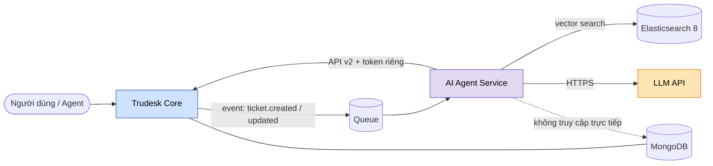
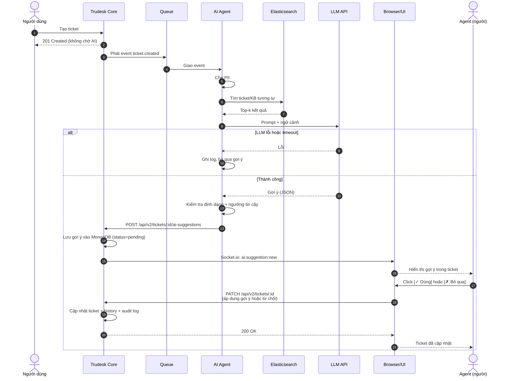
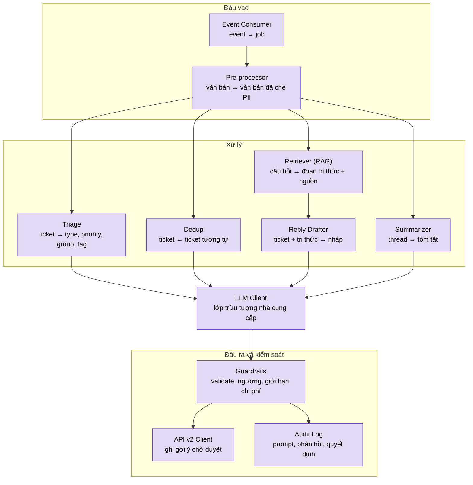
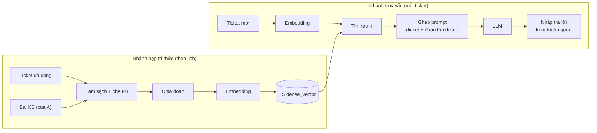
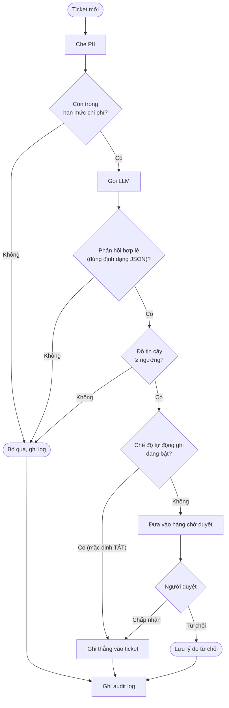

# Sơ đồ AI Agent Service

> Xem trước: VS Code (extension "Markdown Preview Mermaid Support") hoặc GitHub. Xuất ảnh: https://mermaid.live → Actions → SVG/PNG.
> Quy ước màu: xanh dương = Trudesk Core, tím = AI Agent, cam = hệ thống ngoài, hình trụ = nơi lưu dữ liệu.
> Lưu ý: tên module là đề xuất, cần khớp với code thực tế của người B và hợp đồng sự kiện đã chốt với A.

## 1. Ngữ cảnh và vị trí của AI trong hệ thống



## 2. Tuần tự xử lý ticket mới



> **Cơ chế hiển thị gợi ý:**
> - Core lưu gợi ý → phát Socket.io event (real-time)
> - Trình duyệt Agent lắng nghe → hiển thị cảnh báo ngay
> - Agent duyệt (click button) → gửi PATCH request về Core
> - Core áp dụng gợi ý → cập nhật ticket + ghi audit log
>
> **Endpoint cần thêm (người A):**
> - `POST /api/v2/tickets/:id/ai-suggestions` (AI gửi gợi ý)
> - `PATCH /api/v2/tickets/:id` (Agent duyệt, phần body có flag `applyAISuggestions`)
> - Socket event: `ai:suggestion:new` (Core phát khi có gợi ý mới)

## 3. Kiến trúc bên trong AI Agent Service



## 4. Luồng dữ liệu RAG



> Hai bước Embedding phải dùng cùng một mô hình, nếu không kết quả tìm kiếm sai.

## 5. Guardrails và human-in-the-loop



> Ngưỡng tin cậy cụ thể (ví dụ 0.7) cần điền sau khi đo trên bộ test 30–50 ticket có nhãn.

## 6. Ba cách duyệt gợi ý AI (chốt với A, B, C)

> **Người duyệt gợi ý là ai?** Hiện tại sơ đồ 2 chọn **Agent duyệt khi xem ticket** (Cách 1). Hai cách khác nêu dưới để tham khảo.

### Cách 1 (MVP - khuyến khích): Agent duyệt khi xem ticket

```
Agent mở ticket #123
    ↓
Thấy section "🤖 AI Gợi ý" trong ticket
    ├─ Type: Incident (0.92) ✓
    ├─ Priority: High (0.88) ✓
    └─ Gợi ý gán: John (0.87) ✓
    
Nhấp [✓ Dùng tất cả] hoặc [Chọn riêng từng field]
    ↓
Ticket cập nhật ngay
Ghi history: "agent_name duyệt gợi ý AI"
Ghi audit: "timestamp, agent, fields duyệt"
```

**Ưu:** ✅ Đơn giản, nhanh, agent quyết định trực tiếp
**Nhược:** ❌ Nếu agent không duyệt thì gợi ý hết hạn (tự xóa sau 1-6 giờ)

**Lưu trữ:**
```javascript
AIsuggestion {
  ticketId: ObjectId,
  suggestions: {
    type: { value, confidence },
    priority: { value, confidence },
    assignee: { value, confidence },
    ...
  },
  status: "pending",        // pending / approved / rejected / expired
  createdAt: Date,
  expiresAt: Date,          // 1-6 giờ
  approvedAt: Date,         // lúc agent duyệt
  approvedBy: ObjectId,     // user_id
  appliedAt: Date           // lúc áp dụng vào ticket
}
```

---

### Cách 2 (Giai đoạn 2): Mod/Admin duyệt tập trung

```
Trang riêng: "Gợi ý chờ duyệt" (admin dashboard)

GET /api/v2/admin/ai-suggestions?status=pending
    ↓
Mod Sarah thấy 5 gợi ý từ AI
    ├─ Ticket #123: Type: Incident
    ├─ Ticket #124: Priority: High
    └─ ...
    
Batch duyệt / từ chối:
  [✓ Duyệt tất cả] [Duyệt riêng lẻ] [Từ chối]
    ↓
Core cập nhật ticket + gợi ý
Ghi audit: "sarah (admin) duyệt gợi ý #123, #124, ..."
```

**Ưu:** ✅ Tập trung kiểm soát, có audit trail đầy đủ
**Nhược:** ❌ Bottleneck (1-2 mod phải duyệt tất cả), delay ticket

---

### Cách 3 (Aggressive): Tự động nếu confidence cao

```
Quy tắc:
  confidence >= 0.95: áp dụng ngay, không cần duyệt ✅
  0.7 <= confidence < 0.95: chờ agent duyệt ⏳
  confidence < 0.7: bỏ qua ❌

Ticket #123:
  Type: Incident (0.97) → áp dụng ngay ✓
  Priority: High (0.85) → chờ agent duyệt
  Assignee: John (0.68) → bỏ qua
```

**Ưu:** ✅ Nhanh nhất, giảm công việc duyệt
**Nhược:** ❌ Rủi ro cao (nếu AI sai, khó rollback), cần monitor

---

### Kiến nghị cho 3 ngày

**Chọn Cách 1 (Agent duyệt):**
- ✅ MVP đơn giản nhất
- ✅ Agent kiểm soát trực tiếp
- ✅ Dễ vẽ UI
- ❌ Cần handle: gợi ý hết hạn sau bao lâu?

**Điểm cần chốt:**
1. Hạn hết gợi ý: 1 giờ, 6 giờ, hay mãi mãi?
2. Agent có chọn field riêng lẻ không? (dùng Type + Priority, bỏ Assignee)
3. Gợi ý nào được áp dụng thì có thêm endpoint `/api/v2/tickets/:id/ai-suggestions` hay xài endpoint `/api/v2/tickets/:id` hiện có?
