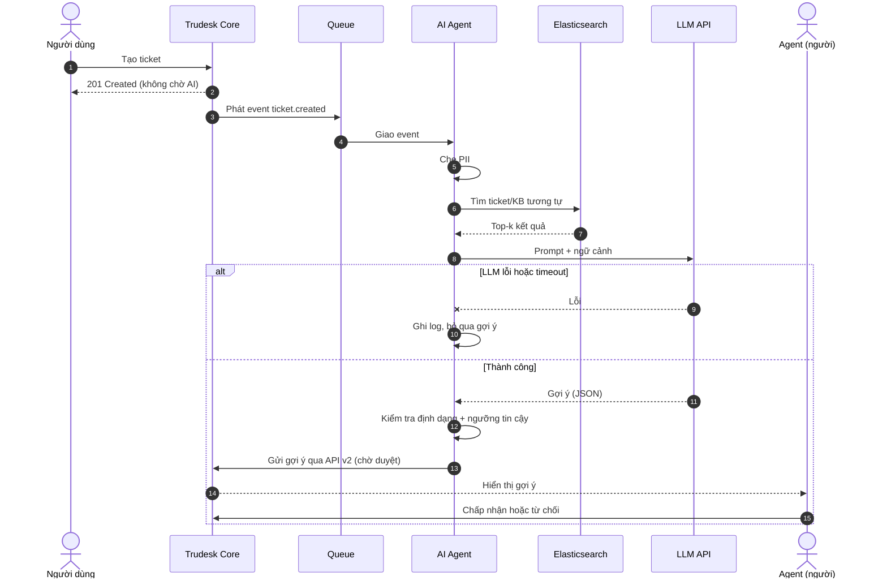
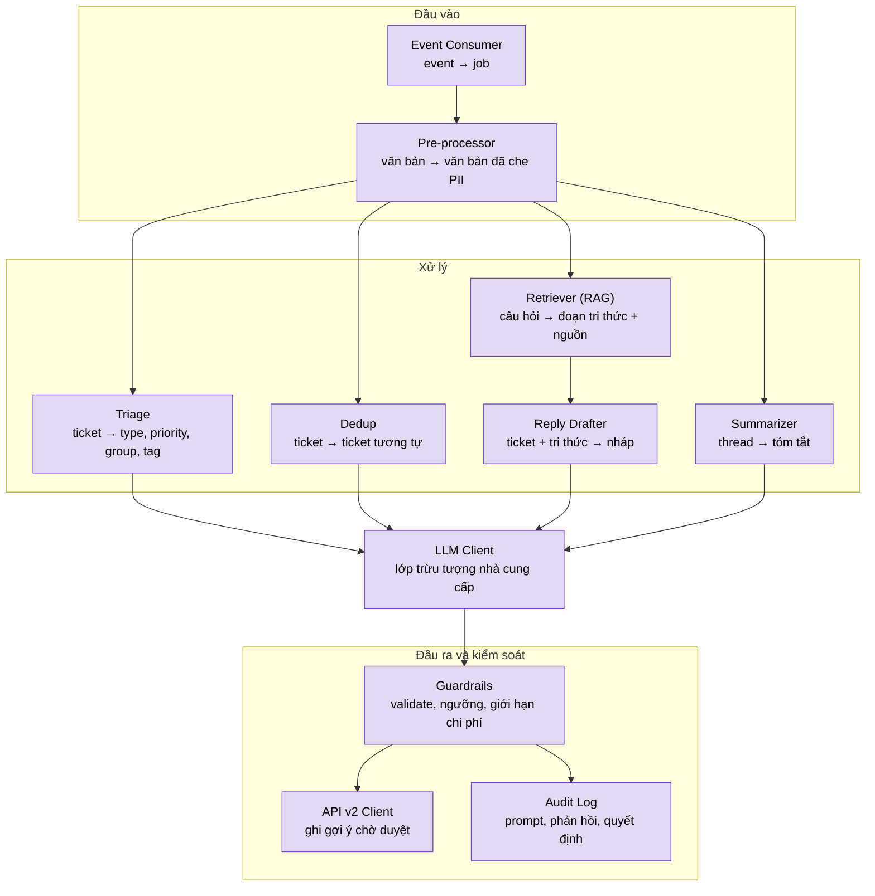
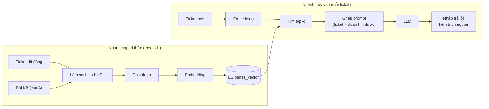

# Sơ đồ AI Agent Service

> Xem trước: VS Code (extension "Markdown Preview Mermaid Support") hoặc GitHub. Xuất ảnh: https://mermaid.live → Actions → SVG/PNG.
> Quy ước màu: xanh dương = Trudesk Core, tím = AI Agent, cam = hệ thống ngoài, hình trụ = nơi lưu dữ liệu.
> Lưu ý: tên module là đề xuất, cần khớp với code thực tế của người B và hợp đồng sự kiện đã chốt với A.

## 1. Ngữ cảnh và vị trí của AI trong hệ thống

## 2. Tuần tự xử lý ticket mới

> Cần chốt với A: API v2 hiện chưa có endpoint "gợi ý". Gợi ý sẽ ghi dưới dạng internal note hay A thêm endpoint mới? Sơ đồ phải khớp lựa chọn này.

## 3. Kiến trúc bên trong AI Agent Service

## 4. Luồng dữ liệu RAG

> Hai bước Embedding phải dùng cùng một mô hình, nếu không kết quả tìm kiếm sai.

## 5. Guardrails và human-in-the-loop

> Ngưỡng tin cậy cụ thể (ví dụ 0.7) cần điền sau khi đo trên bộ test 30–50 ticket có nhãn.
