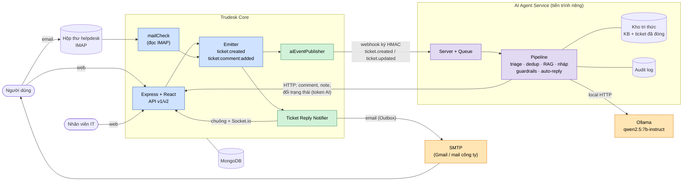
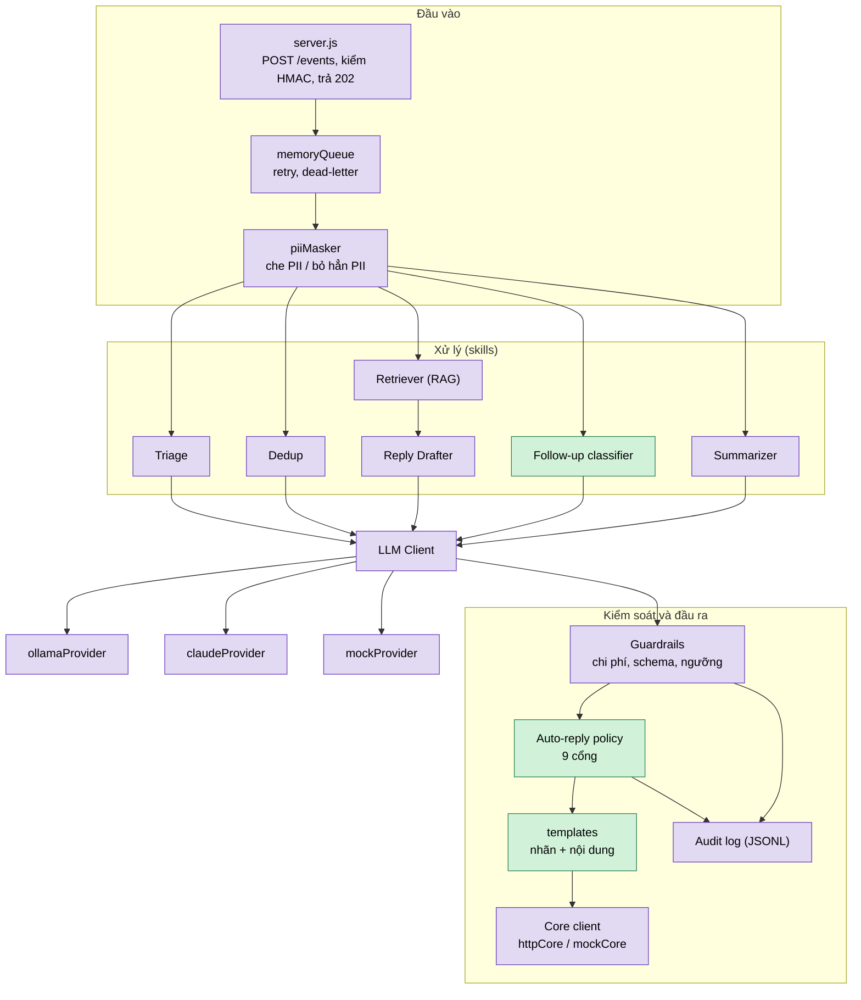
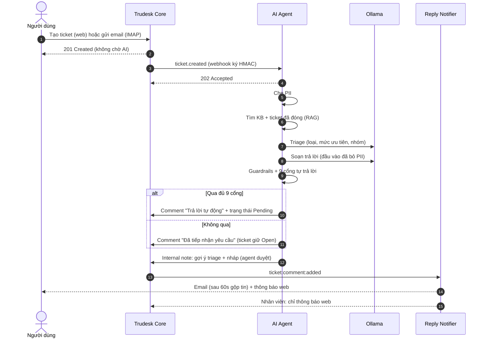
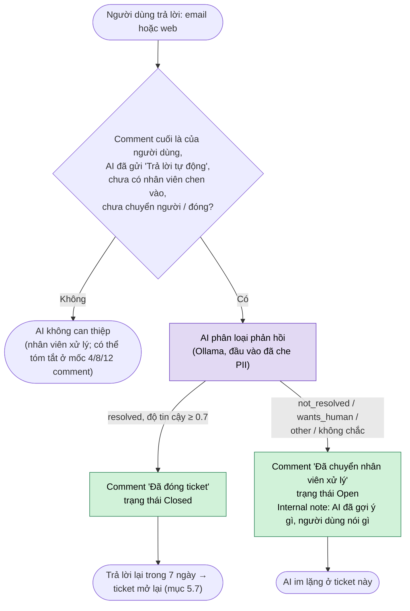
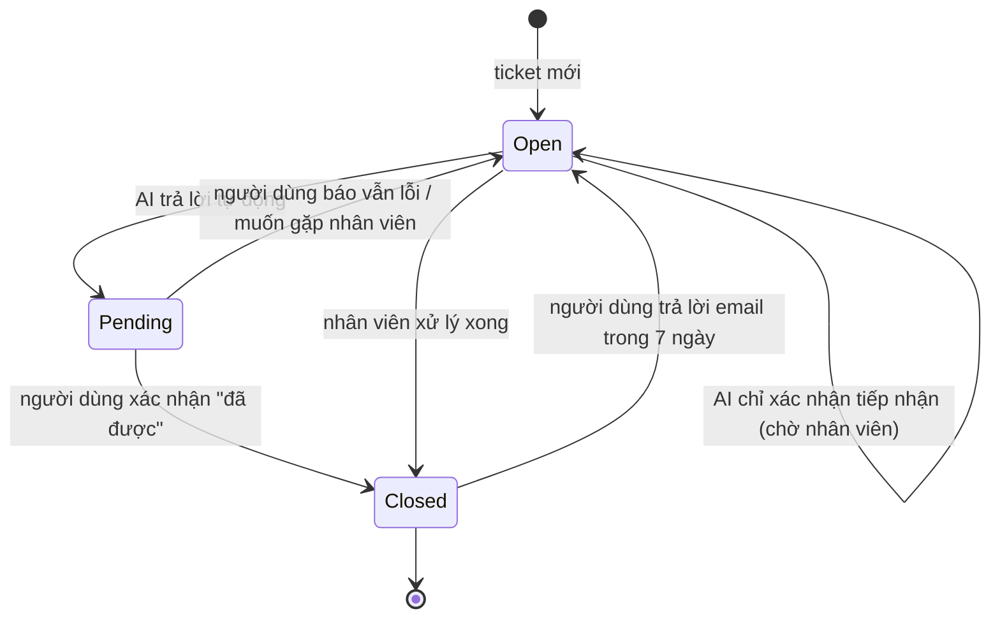
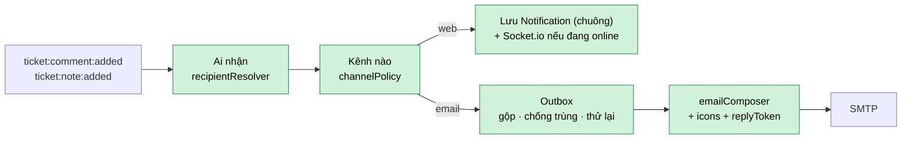
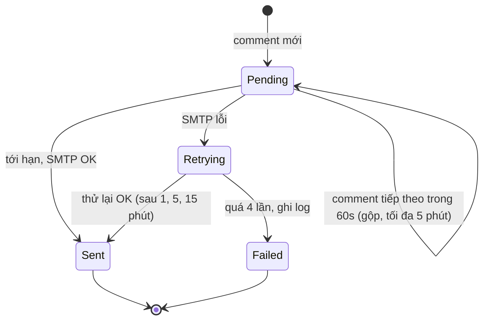
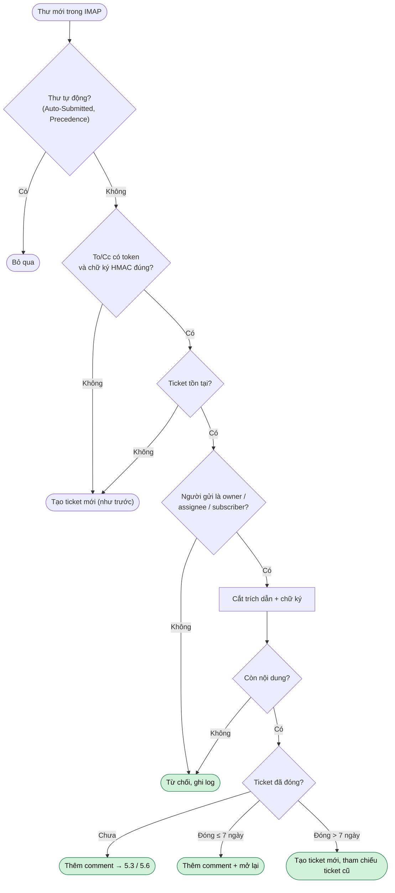

# Kiến trúc và luồng hệ thống sau mở rộng: AI Agent, trả lời tự động, thông báo web + email

> **Phạm vi:** những gì đã được xây dựng trên nền Trudesk 1.2.11 so với [system-architecture.md](system-architecture.md): AI Agent Service (hiện thực [ai-agent-diagrams.md](ai-agent-diagrams.md)), **trả lời email tự động bằng model local (Ollama)**, và **thông báo phản hồi ticket qua web + email**, kể cả khi người dùng trả lời ngược lại bằng email.
> **Trạng thái:** chạy được bằng mock data; đã chạy thật với Ollama (`qwen2.5:7b-instruct`) và gửi thật qua SMTP Gmail. Phần nối vào MongoDB thật chưa được chạy thử (mục 10).
> **Quy ước màu sơ đồ** (giữ như tài liệu gốc): xanh dương = Trudesk Core, tím = AI Agent, cam = hệ thống ngoài, xanh lá = thành phần mới; hình trụ = nơi lưu dữ liệu.

---

## 1. Tóm tắt thay đổi

| # | Thay đổi | Nằm ở | Ghi chú |
|---|---|---|---|
| 1 | **AI Agent Service**: che PII, phân loại (triage), tìm ticket trùng, RAG soạn trả lời, tóm tắt, guardrails, audit | `ai-agent/` (service riêng) | Hiện thực sơ đồ 1–6 của ai-agent-diagrams.md |
| 2 | **Trả lời tự động** cho người dùng khi qua đủ 9 cổng kiểm tra; hiểu phản hồi của người dùng để đóng ticket hoặc chuyển nhân viên | `ai-agent/src/autoreply/` | Model chạy local qua Ollama |
| 3 | **Ticket Reply Notifier**: báo phản hồi qua web (chuông + Socket.io) và email (gộp tin, chống trùng, thử lại) | `src/notifications/ticketReply/` | Thay luồng thông báo cũ trong `events.js` |
| 4 | **Trả lời bằng email**: Reply-To có chữ ký, thư trả lời thành comment trong ticket | `mailCheck.js` + `inboundReply.js` | Trước đây mọi thư đến đều tạo ticket mới |
| 5 | **Icon email** lấy từ bộ Material Design Icons có sẵn của Trudesk, vẽ thành PNG nhúng | `icons.js` | Không tải ảnh từ web, không emoji |
| 6 | Tùy chọn kênh nhận thông báo cho từng người | `src/models/user.js` | `preferences.notifications` |
| 7 | Sửa 2 lỗi cũ trong `events.js` | `src/emitter/events.js` | Sai ngoặc `_.filter`; `return cb` không gọi callback |

## 2. Kiến trúc tổng thể



**Nguyên tắc kiến trúc**

1. **AI tách khỏi Core.** AI chỉ nhận sự kiện và gọi API bằng token của tài khoản dịch vụ `ai.assistant`, không đọc MongoDB. AI chậm hay chết thì ticket vẫn được tạo và xử lý bình thường: Core trả 201 ngay, sự kiện gửi bất đồng bộ với timeout 3 giây.
2. **AI nói với người dùng như một nhân viên.** Câu trả lời tự động là một comment công khai của `ai.assistant`, nên đi qua đúng một đường thông báo (Notifier) như phản hồi của người thật. Không có đường gửi email riêng cho AI.
3. **Dữ liệu không rời hạ tầng.** Model chạy local qua Ollama. PII bị che trước khi vào model, và bị bỏ hẳn khỏi kho tri thức.
4. **Mặc định an toàn.** Không qua đủ cổng thì không tự gửi, chỉ xác nhận tiếp nhận. Mỗi ticket AI chỉ tự trả lời 1 lần. Có nhân viên tham gia thì AI im lặng.

## 3. Hợp đồng giao tiếp Core ↔ AI Agent

### 3.1 Sự kiện Core → AI ([aiEventPublisher.js](../src/emitter/aiEventPublisher.js))

Bật khi đặt `AI_AGENT_WEBHOOK_URL`. Gửi `POST /events`, header `X-Trudesk-Signature: sha256=<HMAC body>`.

```json
{
  "id": "ticket.created:1042:1794880861000:a1b2c3",
  "type": "ticket.created",
  "version": 1,
  "occurredAt": "2026-11-17T02:00:00.000Z",
  "data": {
    "ticket": {
      "_id": "…", "uid": 1042, "subject": "…", "issue": "…",
      "group": "…", "type": "…", "priority": "…", "status": "…",
      "comments": [{ "text": "<p>…</p>", "authorRole": "user | agent" }]
    }
  }
}
```

| Emitter nội bộ (Core) | Sự kiện gửi AI | AI dùng để |
|---|---|---|
| `ticket:created` | `ticket.created` | Triage, dedup, soạn trả lời, quyết định tự trả lời |
| `ticket:comment:added` | `ticket.updated` | Hiểu phản hồi của người dùng sau câu trả lời tự động; tóm tắt thread ở mốc 4, 8, 12… comment |

Payload không gửi email/SĐT của người tạo. Tên sự kiện gửi ra ngoài dùng dấu chấm, để phân biệt với emitter nội bộ dùng dấu hai chấm. AI chống xử lý trùng theo `id`.

### 3.2 AI → Core ([httpCore.js](../ai-agent/src/core/httpCore.js), API v1, header `accesstoken`)

AI **chỉ dùng API v1**. API v2 xác thực bằng JWT (`Authorization: Bearer`), mà `/api/v2/login` và `/api/v2/token` của Trudesk 1.2.11 có lỗi (`await` một hàm chỉ hỗ trợ callback) nên service không lấy được JWT. Token của tài khoản `ai.assistant` được tạo bằng `POST /api/v1/users/:id/generateapikey` (xem [run-guide.md](run-guide.md), bước 4).

| Mục đích | API | Ghi chú |
|---|---|---|
| Đọc ticket | `GET /api/v1/tickets/:uid` | Có sẵn |
| Gửi phản hồi công khai (trả lời / xác nhận / chuyển người / đóng) | `POST /api/v1/tickets/addcomment` | Có sẵn. Core phát `ticket:comment:added` → Notifier |
| Ghi chú nội bộ cho nhân viên | `POST /api/v1/tickets/addnote` | Có sẵn |
| Đổi trạng thái (Pending / Open / Closed) | `GET /api/v1/tickets/status` + `PUT /api/v1/tickets/:id` (`status`, `closedDate`) | Có sẵn |
| Gợi ý triage chờ duyệt | Mặc định ghi thành internal note; hoặc `POST /api/v1/tickets/:uid/ai-suggestions` | Endpoint thứ hai là **đề xuất**, chưa có trong Core (`AI_SUGGESTION_SINK=endpoint`) |

### 3.3 Nhãn phản hồi tự động

Dòng đầu mỗi comment của AI là một nhãn chữ thuần. Nhãn giúp người đọc biết đây là trả lời tự động, giúp AI nhận ra comment của chính mình khi đọc lại thread, và giúp email thay nhãn bằng icon.

| Loại | Nhãn | Icon trong email (Material Design Icons của Trudesk) |
|---|---|---|
| `answer` | `Bộ phận IT · Trả lời tự động` | `mdi-hardware-headset-mic` |
| `ack` | `Bộ phận IT · Đã tiếp nhận yêu cầu` | `mdi-action-assignment-turned-in` |
| `handoff` | `Bộ phận IT · Đã chuyển nhân viên xử lý` | `mdi-action-swap-horiz` |
| `closed` | `Bộ phận IT · Đã đóng ticket` | `mdi-action-check-circle` |

Định nghĩa ở 2 nơi phải khớp nhau, có test kiểm tra: [autoReplyKinds.js](../src/notifications/ticketReply/autoReplyKinds.js) (Core) và `MARKERS` trong [templates.js](../ai-agent/src/autoreply/templates.js) (AI).

## 4. Kiến trúc bên trong AI Agent Service



| Khối | File | Ghi chú |
|---|---|---|
| Server, Queue | [server.js](../ai-agent/src/server.js), [memoryQueue.js](../ai-agent/src/queue/memoryQueue.js) | Lỗi mạng/LLM tạm thời thì thử lại; thay bằng SQS khi lên cloud. Mỗi sự kiện xử lý xong in một dòng log (`ticket.created #1001 -> suggested, answer 42.3s`) |
| Cấu hình | [config.js](../ai-agent/src/config.js), [env.js](../ai-agent/src/env.js) | `npm run ai-agent` tự đọc `ai-agent/.env`; biến đặt sẵn trong shell được ưu tiên |
| Pipeline | [pipeline.js](../ai-agent/src/pipeline.js) | Điều phối toàn bộ; mọi lỗi chỉ làm mất gợi ý, không chặn ticket |
| Che PII | [piiMasker.js](../ai-agent/src/preprocess/piiMasker.js) | `mask` (có thể khôi phục cho nháp agent duyệt) và `dropTags` (bỏ hẳn: kho tri thức, đầu vào soạn trả lời) |
| Skills | [skills/index.js](../ai-agent/src/skills/index.js) | Prompt đánh dấu nội dung ticket là dữ liệu (chống prompt injection); xưng "IT", gọi "anh/chị" |
| RAG | [rag/](../ai-agent/src/rag/) | Kho vector bộ nhớ mô phỏng ES `dense_vector`; chỉ nạp bài KB `Published` |
| LLM Client | [llmClient.js](../ai-agent/src/llm/llmClient.js) | `AI_PROVIDER=ollama` (mặc định khi chạy thật), `claude`, `mock` |
| Guardrails | [guardrails.js](../ai-agent/src/guardrails/guardrails.js), [schemas.js](../ai-agent/src/llm/schemas.js) | Hạn mức chi phí → JSON đúng schema → ngưỡng tin cậy |
| Auto-reply | [policy.js](../ai-agent/src/autoreply/policy.js), [templates.js](../ai-agent/src/autoreply/templates.js) | Mục 5.2, 5.3 |

## 5. Các luồng chính

### 5.1 Ticket mới



### 5.2 Quyết định tự trả lời: 9 cổng ([policy.js](../ai-agent/src/autoreply/policy.js))

Phải qua **tất cả** mới tự gửi. Trượt một cổng thì gửi xác nhận tiếp nhận; nháp vẫn để agent duyệt.

| Cổng | Điều kiện | Lý do |
|---|---|---|
| `enabled` | `AI_AUTO_REPLY` khác `false` | Công tắc tổng |
| `first-answer` | AI chưa từng trả lời ticket này | Tối đa 1 lần; người dùng chưa hài lòng thì chuyển người, không để bot lặp |
| `type-allowed` | Loại = **Incident** | Người dùng tự sửa theo hướng dẫn được. Service Request cần IT thao tác thật (cấp quyền, cài đặt) |
| `priority-allowed` | Không phải **Critical** | Sự cố nghiêm trọng phải có người ngay |
| `triage-confident` | Loại và mức ưu tiên ≥ 0.7 | Phải biết chắc đang trả lời loại việc gì |
| `grounded` | Có trích nguồn thật, nguồn khớp ticket ≥ 0.3 | Không trả lời khi không có tài liệu (vd "wifi cả công ty sập" chỉ khớp bài VPN 0.21) |
| `draft-confident` | Độ tin cậy nháp ≥ 0.7 | |
| `safe-content` | Không đòi mật khẩu/OTP; không nói "đã cấp quyền / đã reset"; không có link ngoài tài liệu; không nhắc nhãn PII; dài 60–3000 ký tự | Chặn nội dung sai hoặc nguy hiểm |
| `single-user` | Không có "cả phòng", "toàn công ty", "nhiều người"… | Luật cố định, **không dựa vào model** (mục 9) |

### 5.3 Người dùng phản hồi sau câu trả lời tự động



Khi không chắc, AI luôn **chuyển người**. Chỉ đóng ticket khi người dùng xác nhận rõ ràng.

### 5.4 Vòng đời ticket khi có AI



Trạng thái Pending nghĩa là chờ người dùng. Đồng hồ SLA có dừng hay không phụ thuộc cờ `slatimer` của status Pending trong Trudesk.

### 5.5 Agent duyệt gợi ý (khi AI không tự trả lời)

Theo **Cách 1** của sơ đồ 6, với các điểm cần chốt được chọn như sau:

- Gợi ý hết hạn sau **6 giờ** (`AI_SUGGESTION_TTL_MS`).
- Agent **chọn được từng trường**, vd dùng type + group, bỏ priority.
- Gợi ý ghi bằng **internal note**: chạy ngay mà không phải sửa Core.

Nháp chỉ thành phản hồi khi agent bấm dùng (có thể sửa trước). Từ đó nó đi vào luồng thông báo ở 5.6 như mọi phản hồi khác. Luồng này minh họa ở `npm run demo:e2e`.

### 5.6 Thông báo phản hồi: web + email ([src/notifications/ticketReply/](../src/notifications/ticketReply/))



**Ai nhận**

| Tình huống | Người nhận |
|---|---|
| Nhân viên hoặc AI trả lời công khai | Người tạo ticket + người theo dõi, trừ người viết |
| Người dùng trả lời (web hoặc email) | Nhân viên được giao + người theo dõi, trừ người viết |
| Ghi chú nội bộ | **Chỉ nhân viên, chỉ web**. Người dùng không bao giờ nhận |
| Tài khoản đã xóa, bản trùng | Bỏ qua |

**Kênh nào**: `user.preferences.notifications.channel` = `both` (mặc định) / `web` / `email` / `none`, kèm `skipEmailWhenOnline`.

- Người không có quyền vào web (gửi ticket qua email): chỉ nhận email.
- Mailer tắt hoặc không có địa chỉ email: bỏ email. Nếu vì vậy mà không còn kênh nào, chuyển sang gửi web để không mất thông báo.
- **Phản hồi do bot viết:** người dùng nhận email; nhân viên chỉ nhận web, tránh spam hộp thư.

**Outbox email**



- **Chống trùng:** khóa `commentId:recipientId:email`. Sự kiện bị phát lại không gây gửi hai lần.
- **Kênh độc lập:** SMTP lỗi vẫn có thông báo web.

### 5.7 Email gửi đi và email trả lời đi vào

**Email gửi đi** ([emailComposer.js](../src/notifications/ticketReply/emailComposer.js))

| Thành phần | Giá trị | Mục đích |
|---|---|---|
| From | Hộp thư helpdesk đã cấu hình | Gmail luôn đặt From là chính tài khoản đăng nhập SMTP (mục 8.2) |
| Subject | `[Ticket #1042] Re: <tiêu đề>` | Cố định theo ticket |
| Message-ID / In-Reply-To / References | `<ticket-1042-c-…@domain>` / `<ticket-1042@domain>` | Gmail/Outlook gom thành một luồng |
| Reply-To | `<hộp thư>+t1042.<HMAC 10 ký tự>@domain` | Trả lời thẳng từ hộp thư, quay về đúng ticket |
| Dòng đánh dấu | `##- Vui lòng trả lời phía trên dòng này -##` | Cắt phần trích dẫn khi đọc thư trả lời |
| `Auto-Submitted: auto-generated` | | Thư vắng mặt không tạo vòng lặp |
| Icon | PNG nhúng (CID) | Mục 6 |

**Email trả lời đi vào** ([inboundReply.js](../src/notifications/ticketReply/inboundReply.js), gắn trong [mailCheck.js](../src/mailer/mailCheck.js))



## 6. Icon trong email

Gmail/Outlook không hiển thị webfont hay SVG nhúng. [icons.js](../src/notifications/ticketReply/icons.js) xử lý như sau:

1. Tra tên lớp `mdi-*` ra mã glyph trong `src/sass/materialize/components/_icons-material-design.scss`.
2. Lấy hình vẽ (path) của glyph từ `public/font/material-design-icons/Material-Design-Icons.svg`. Đây là bộ icon giao diện Trudesk đang dùng.
3. Vẽ thành PNG 40×40, hiển thị ở 20×20 cho màn hình độ phân giải cao, khử răng cưa. Chỉ dùng `zlib` có sẵn của Node, không thêm thư viện.
4. Đính kèm nội tuyến (`cid:mdi-…@helpdesk`), không tải ảnh nào từ internet.

Nội dung comment không chứa emoji. Trên web, người dùng thấy nhãn chữ (mục 3.3); trong email, nhãn được thay bằng icon kèm chữ.

## 7. Bảo mật và an toàn dữ liệu

| Rủi ro | Biện pháp |
|---|---|
| Lộ PII ra model hoặc vào câu trả lời | Che PII trước khi gọi model. Kho tri thức và đầu vào soạn trả lời bỏ hẳn câu chứa PII. Nội dung tự gửi là bản còn che, và bị chặn nếu còn nhãn PII |
| Model chạy ngoài hạ tầng | Ollama local; `claude` chỉ dùng khi chủ động cấu hình |
| Giả mạo webhook vào AI | HMAC-SHA256 trên body (`AI_AGENT_WEBHOOK_SECRET`) |
| Chèn comment vào ticket người khác qua email | Reply-To ký HMAC + kiểm tra người gửi là người trong ticket |
| Vòng lặp email (bot ↔ thư vắng mặt) | `Auto-Submitted` khi gửi; bỏ qua thư tự động khi nhận; AI trả lời tối đa 1 lần mỗi ticket |
| Prompt injection trong nội dung ticket | Prompt đánh dấu `<ticket>`, `<context>` là dữ liệu; đầu ra bắt buộc đúng JSON schema; mọi trích nguồn phải có thật |
| AI tự nhận đã làm việc nó không làm | Cổng `safe-content` chặn "đã cấp quyền / đã reset / đã mở khóa…" |
| Truy vết | Audit JSONL: prompt (đã che), phản hồi, quyết định từng cổng, token, thời gian |
| Minh bạch với người dùng | Mọi phản hồi của AI ghi rõ "Trả lời tự động", có nguồn, và hướng dẫn cách gặp nhân viên |

## 8. Cấu hình và vận hành

### 8.1 Biến môi trường chính

| Biến | Bên | Mặc định | Ý nghĩa |
|---|---|---|---|
| `TICKET_REPLY_NOTIFY` | Core | `v2` | `legacy` để quay về thông báo cũ |
| `TICKET_NOTIFY_MAIL_MODE` | Core | `smtp` | `mock` ghi `.eml` vào `logs/mock-mailbox` |
| `TICKET_NOTIFY_DEBOUNCE_MS` | Core | `60000` | Thời gian gộp email |
| `TICKET_REPLY_SECRET` | Core | `tokens:secret` | Khóa HMAC cho Reply-To |
| `TICKET_REPLY_MAILBOX` | Core | hộp IMAP | Hộp thư nhận thư trả lời |
| `AI_AGENT_WEBHOOK_URL`, `AI_AGENT_WEBHOOK_SECRET` | Core | (tắt) | Đẩy sự kiện sang AI |
| `AI_BOT_USERNAME` | Core | `ai.assistant` | Tài khoản dịch vụ của AI |
| `AI_PROVIDER` | AI | `mock` | `ollama`, `claude`, `mock` |
| `OLLAMA_URL`, `OLLAMA_MODEL` | AI | `http://localhost:11434`, `qwen2.5:7b-instruct` | Model local |
| `OLLAMA_NUM_CTX`, `OLLAMA_NUM_PREDICT`, `OLLAMA_TIMEOUT_MS` | AI | `4096`, `1024`, `180000` | Hiệu năng (mục 9) |
| `AI_AUTO_REPLY`, `AI_AUTO_REPLY_TYPES`, `AI_AUTO_REPLY_BLOCKED_PRIORITIES` | AI | `true`, `Incident`, `Critical` | Trả lời tự động |
| `AI_AUTO_REPLY_MIN_CONFIDENCE`, `AI_AUTO_REPLY_MIN_GROUNDING` | AI | `0.7`, `0.3` | Ngưỡng cổng |
| `AI_CONFIDENCE_THRESHOLD`, `AI_AUTO_APPLY` | AI | `0.7`, `false` | Guardrails triage |
| `CORE_MODE`, `TRUDESK_URL`, `TRUDESK_AI_TOKEN`, `AI_SUGGESTION_SINK` | AI | `mock`, …, `internal-note` | Kết nối Core |

Danh sách đầy đủ: [ai-agent/.env.example](../ai-agent/.env.example).

### 8.2 Người gửi email

Email đi ra từ hộp thư dùng để đăng nhập SMTP. Với Gmail, From luôn là tài khoản đã đăng nhập (hoặc alias đã xác minh), còn tên hiển thị thì tùy chỉnh được. Thư trả lời quay về cùng hộp đó, qua địa chỉ `+t<ticket>`.

Khi dùng thật nên tạo **hộp thư riêng cho helpdesk** (vd `support@tencongty.vn`), khai báo ở Trudesk Settings → Mailer, và dùng chính hộp đó cho IMAP. Không nên dùng tài khoản cá nhân.

### 8.3 Chạy thử

Hướng dẫn chạy đầy đủ với Trudesk thật (MongoDB, tài khoản AI, token, SMTP, IMAP, xử lý sự cố): [run-guide.md](run-guide.md).

```bash
npm run demo:auto-reply     # AI (Ollama) tự trả lời → người dùng phản hồi → đóng ticket / chuyển nhân viên
npm run demo:e2e            # AI gợi ý → agent duyệt nháp → thông báo web + email → reply email
node demo/send-real-email.js --to <email> [--ticket 1047] [--dry-run] [--mock]
                            # gửi THẬT qua SMTP Gmail (GMAIL_USER, GMAIL_APP_PASSWORD trong ai-agent/.env)
npm run ai-agent:eval       # bảng độ chính xác triage (AI_PROVIDER=ollama để đo model thật)
npm run test:unit           # 58 test, không cần MongoDB
npm run ai-agent            # chạy AI Agent Service ở cổng 8200
```

## 9. Số liệu đo được và bài học từ model thật

Đo trên máy phát triển: Ollama 0.40, `qwen2.5:7b-instruct` Q4, RTX 2070 4 GB VRAM.

| Hạng mục | Kết quả |
|---|---|
| Độ chính xác triage (8 ticket mock có nhãn) | Nhóm 100%, mức ưu tiên 88%, loại 75% (sai: Change → Service Request, Problem → Incident). Mẫu rất nhỏ, chỉ để định hướng |
| Thời gian xử lý ticket mới | 10–95 giây (2–3 lần gọi model). Không ảnh hưởng người tạo ticket vì xử lý bất đồng bộ |
| Thời gian phân loại phản hồi | 5–9 giây |
| Gửi thật qua Gmail SMTP | Thành công (`250 2.0.0 OK`), Reply-To dạng `+t1042.<sig>` |

| Hiện tượng chỉ thấy khi chạy model thật | Xử lý |
|---|---|
| Model hiểu nhầm `[PHONE_1]` là số của IT ("liên hệ IT qua số …"), kể cả số của người trong ticket cũ | Bỏ hẳn câu chứa PII khỏi kho tri thức và đầu vào soạn trả lời; cổng `safe-content` chặn nếu còn nhãn |
| Đường dẫn `\\fileserver\...` khiến model lặp vô hạn khi escape JSON | Đổi `\\` → `//` trước khi gửi; giới hạn `num_predict` |
| `num_ctx: 8192` tràn VRAM 4 GB: 2.3 token/s | `num_ctx: 4096`: **45 token/s** |
| Trả về `confidence: 100`, `citations: ["[KB-101] Tiêu đề"]` | Chuẩn hóa trong [ollamaProvider.js](../ai-agent/src/llm/providers/ollamaProvider.js) |
| Chèn "Confidence: High", "[Citation: …]" vào thân thư; xưng hô lẫn lộn | Làm sạch dòng siêu dữ liệu; prompt quy định xưng hô |
| Gán sự cố "cả phòng" là Incident với độ tin cậy 0.95 | Cổng `single-user` bằng luật cố định. Độ tin cậy do model tự báo không đáng tin |

## 10. Giới hạn và việc còn lại

| Hạng mục | Hiện trạng | Việc cần làm | Người |
|---|---|---|---|
| Tích hợp MongoDB thật | Trudesk đã khởi động được với code mới (kết nối MongoDB, bật chuyển sự kiện sang AI). Luồng ticket → AI → comment → thông báo trên dữ liệu thật **chưa chạy hết** | Làm theo kịch bản thử ở [run-guide.md](run-guide.md) mục 8; chạy `npm test` trên CI có MongoDB | A, C |
| Tài khoản AI trong Core | Cần tạo tay trên mỗi môi trường | Tạo user `ai.assistant` (role Support), lấy token (run-guide.md bước 4) | A, C |
| IMAP với Gmail | Chưa cấu hình | Bật IMAP cho hộp helpdesk, khai báo ở Settings → Mailer → Mail Check | C |
| Outbox lưu trong RAM | Mất email đang chờ (tối đa ~5 phút) khi restart; nhiều instance có thể gửi trùng | Store trên MongoDB/Redis + khóa phân tán khi flush | C |
| Giao diện web | Server đã lưu chuông thông báo và phát `$trudesk:client:ticket:reply`; client chưa hiện toast, chưa có màn hình chọn kênh nhận | Listener trong `src/client`, mục chọn kênh trong Profile (dùng icon Material có sẵn) | A |
| Endpoint `ai-suggestions` + UI duyệt | Chưa có; AI đang ghi internal note | Model `AISuggestion`, endpoint, khu "Gợi ý từ AI" trong ticket | A |
| Chất lượng trả lời tự động | Đã chạy thật trên 4 ticket + 2 phản hồi. Model 7B dao động giữa các lần chạy | Đo tỉ lệ tự gửi và tỉ lệ "đã được" trên 30–50 ticket thật; bật trước cho 1 nhóm | B |
| Embedding | Hash bag-of-words, ngưỡng hiệu chỉnh cho mock | Mô hình embedding thật + ES `dense_vector`, đo lại ngưỡng | B, C |
| Claude provider | Viết theo SDK chính thức, chưa chạy thử | Node ≥ 18, `npm install @anthropic-ai/sdk` trong `ai-agent/` | B |

## 11. Danh mục file

**Trudesk Core**

| File | Vai trò |
|---|---|
| [src/emitter/aiEventPublisher.js](../src/emitter/aiEventPublisher.js) | Đẩy sự kiện sang AI (mục 3.1) |
| [src/emitter/events.js](../src/emitter/events.js) | Gọi Notifier cho comment và note; giữ push TPS; sửa 2 lỗi cũ |
| [src/mailer/mailCheck.js](../src/mailer/mailCheck.js) | Đọc thêm To/Cc/Delivered-To, text, header; ghép thư trả lời vào ticket trước khi tạo ticket mới |
| [src/models/user.js](../src/models/user.js) | `preferences.notifications` (có mặc định, không cần migration) |
| [src/notifications/ticketReply/index.js](../src/notifications/ticketReply/index.js) | Notifier: ghép các phần, phụ thuộc được tiêm vào nên test bằng mock |
| [recipientResolver.js](../src/notifications/ticketReply/recipientResolver.js), [channelPolicy.js](../src/notifications/ticketReply/channelPolicy.js) | Ai nhận, kênh nào |
| [outbox.js](../src/notifications/ticketReply/outbox.js) | Gộp, chống trùng, thử lại |
| [emailComposer.js](../src/notifications/ticketReply/emailComposer.js), [replyToken.js](../src/notifications/ticketReply/replyToken.js) | Soạn email, Reply-To có chữ ký |
| [icons.js](../src/notifications/ticketReply/icons.js), [autoReplyKinds.js](../src/notifications/ticketReply/autoReplyKinds.js) | Icon Material → PNG; nhãn phản hồi tự động |
| [inboundReply.js](../src/notifications/ticketReply/inboundReply.js), [inboundHandler.js](../src/notifications/ticketReply/inboundHandler.js) | Email trả lời đi vào |
| [trudeskAdapters.js](../src/notifications/ticketReply/trudeskAdapters.js) | Nối Notifier vào Mongoose, mailer, Socket.io |

**AI Agent Service** (`ai-agent/`): `src/server.js`, `src/env.js`, `src/queue/`, `src/pipeline.js`, `src/bootstrap.js`, `src/config.js`, `src/preprocess/`, `src/skills/`, `src/rag/`, `src/llm/` (providers `ollama`, `claude`, `mock`), `src/guardrails/`, `src/autoreply/`, `src/core/` (`httpCore`, `mockCore`), `src/audit/`; `mock-data/`; `scripts/eval.js`; `test/`.

**Demo và test**: `demo/e2e-auto-reply-ollama.js`, `demo/e2e-ai-reply-notify.js`, `demo/send-real-email.js`, `demo/mock-data/`, `test/unit/ticketReply.js`, `ai-agent/test/`.
