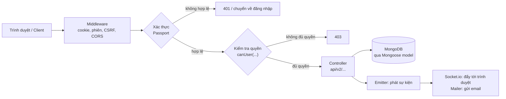
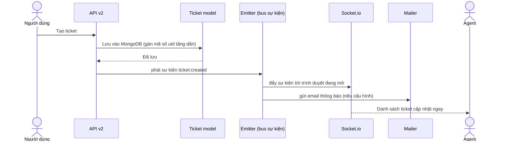
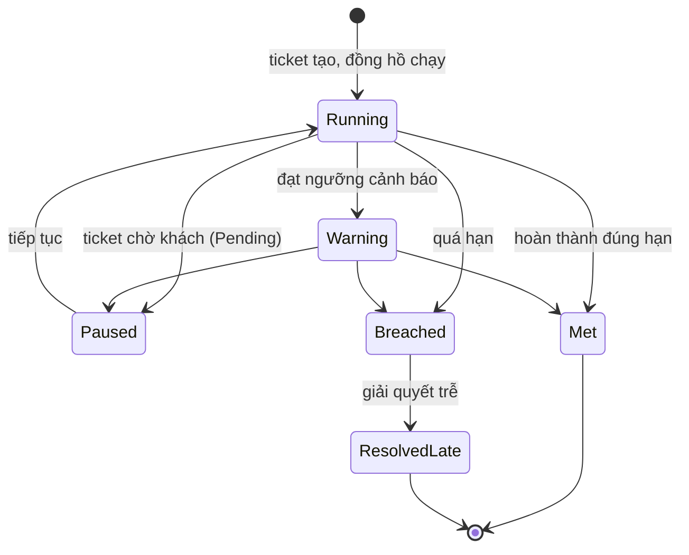
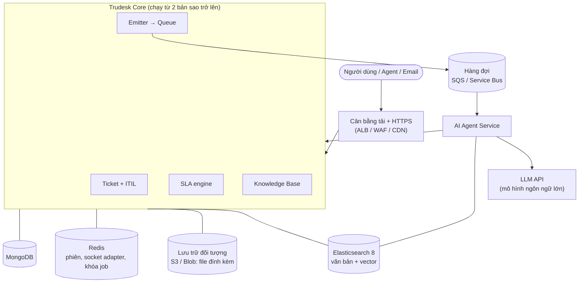

# Cấu trúc và hoạt động của hệ thống Modular ITSM

> **Mục đích:** giải thích hệ thống là gì, gồm những phần nào, chạy ra sao, và phần mở rộng sẽ gắn vào đâu.
> **Cách đọc:** mọi thuật ngữ tiếng Anh hoặc từ viết tắt đều được giải thích ở **mục 10 (Bảng thuật ngữ)**, và ở lần xuất hiện đầu tiên trong bài sẽ có chú thích ngắn trong ngoặc.
> **Quy ước nhãn:**
> - **[Hiện có]**: đã tồn tại trong mã nguồn Trudesk (đã đối chiếu code).
> - **[Đề xuất]**: thiết kế mở rộng, chưa được xây dựng.
>
> **Giới hạn:** tài liệu dựa trên việc đọc có chọn lọc các module chính, không phải rà soát toàn bộ mã nguồn.

---

## 1. Hệ thống là gì?

**ITSM** (*IT Service Management*, quản lý dịch vụ công nghệ thông tin) là cách một tổ chức tiếp nhận, xử lý và theo dõi các yêu cầu hỗ trợ IT. Ví dụ: nhân viên báo "máy in hỏng", bộ phận IT nhận việc, xử lý, rồi đóng yêu cầu.

Dự án này mở rộng **Trudesk** (phiên bản 1.2.11), một phần mềm help desk mã nguồn mở viết bằng Node.js. Mỗi yêu cầu hỗ trợ được gọi là một **ticket** (phiếu yêu cầu).

Ba hướng mở rộng:
1. **Chức năng ITSM:** SLA, phân loại theo ITIL, Knowledge Base.
2. **AI Agent:** tự động gợi ý phân loại, tìm ticket trùng, soạn nháp trả lời.
3. **Triển khai cloud:** chạy nhiều bản sao của hệ thống trên AWS (hoặc Azure).

## 2. Công nghệ đang dùng [Hiện có]

| Lớp | Công nghệ | Vai trò |
|---|---|---|
| Máy chủ | **Node.js** + **Express** | Chạy logic và cung cấp web/API |
| Cơ sở dữ liệu | **MongoDB** + **Mongoose** | Lưu dữ liệu; Mongoose là thư viện ánh xạ dữ liệu sang đối tượng JavaScript |
| Thời gian thực | **Socket.io** | Đẩy thông báo tức thì tới trình duyệt (không cần tải lại trang) |
| Giao diện | **React 17** + **Redux** + **redux-saga**, kèm jQuery cũ | Giao diện web; Redux giữ trạng thái giao diện, saga xử lý các lời gọi bất đồng bộ |
| Tìm kiếm | **Elasticsearch 8** (tùy chọn) | Tìm kiếm toàn văn trên ticket |
| Cache | **node-cache** trong bộ nhớ; thư viện **Redis** có trong `package.json` nhưng đoạn kết nối ở `src/cache/rediscache.js` đang hard-code địa chỉ `127.0.0.1:32819` | Xem mục 9 |
| Đăng nhập | **Passport**, **LDAP**, **MFA/TOTP**, **JWT** | Xem mục 5 |
| Email | **Nodemailer** (gửi), **IMAP** (nhận) | Xem mục 4.4 |
| Chạy tiến trình | **pm2** | Giữ ứng dụng sống và ghi log |
| Đóng gói | **Docker**, manifest **Kubernetes** | Xem mục 8 |

## 3. Cấu trúc thư mục [Hiện có]

```
trudesk/
├── app.js              Điểm khởi động chính của ứng dụng
├── runner.js           Dùng pm2 để chạy app.js và ghi log vào logs/output.log
├── Dockerfile          Đóng gói ứng dụng thành image
├── docker-compose.yml  Chạy thử cả hệ thống (app + MongoDB + Elasticsearch)
├── kubernetes/         Manifest triển khai lên Kubernetes
├── plugins/            Dành cho plugin, hiện trống (chỉ có .gitkeep)
├── mobile/             Ứng dụng di động cũ (Ionic/Angular 1)
├── test/               Test tự động (khoảng 14 file, chạy bằng mocha)
├── docs/               Tài liệu (thư mục này)
└── src/
    ├── webserver.js    Dựng Express, nạp middleware và routes
    ├── socketserver.js Dựng Socket.io
    ├── models/         Định nghĩa dữ liệu (ticket, user, group, team, ...)
    ├── controllers/    Xử lý yêu cầu; api/v1 (cũ), api/v2 (mới)
    ├── routes/         Khai báo đường dẫn URL
    ├── middleware/     Bước xử lý chung trước controller: phiên, bảo mật, CSRF
    ├── passport/       Cấu hình đăng nhập
    ├── permissions/    Vai trò và quyền hạn
    ├── emitter/        Bus sự kiện nội bộ (ticket:created, ticket:updated, ...)
    ├── socketio/       Xử lý sự kiện thời gian thực
    ├── mailer/         Gửi email, kiểm tra hộp thư IMAP, mẫu email
    ├── elasticsearch/  Lập chỉ mục và tìm kiếm
    ├── cache/          Cache và thống kê nhanh
    ├── notifications/  Thông báo trong ứng dụng
    ├── ldap/           Tích hợp LDAP
    ├── backup/         Sao lưu và khôi phục
    ├── migration/      Nâng cấp dữ liệu giữa các phiên bản
    ├── pdf/            Xuất ticket ra PDF
    ├── taskrunner/     Chạy tác vụ định kỳ (hiện gần như trống)
    ├── client/         Mã giao diện React (actions, reducers, sagas, containers)
    └── views/          Trang giao diện dạng template Handlebars
```

**Cách nhớ:** `routes` quyết định "URL nào", `controllers` quyết định "làm gì", `models` quyết định "dữ liệu trông thế nào".

## 4. Hệ thống hoạt động thế nào? [Hiện có]

### 4.1 Khởi động

1. `runner.js` dùng pm2 khởi chạy `app.js`, log ghi vào `logs/output.log`.
2. `app.js` tìm tệp cấu hình `config.yml`. Nếu chưa có, ứng dụng mở **install server** (máy chủ cài đặt) để người dùng nhập thông tin MongoDB, Elasticsearch, tài khoản quản trị. Nếu đã có, ứng dụng nối MongoDB rồi nạp `webserver.js`.
3. `webserver.js` nạp các **middleware**, đăng ký routes, rồi lắng nghe ở cổng **8118**.
4. Ứng dụng có đường dẫn kiểm tra sức khỏe `/healthz`, trả về `OK`, dùng cho load balancer và Kubernetes.

### 4.2 Một yêu cầu API đi qua những bước nào



Ví dụ thật trong `src/controllers/api/v2/routes.js`:
`POST /api/v2/tickets` đi qua `apiv2Auth` (xác thực) rồi `canUser('tickets:create')` (quyền tạo ticket) rồi mới tới `apiv2.tickets.create`.

### 4.3 Vòng đời một ticket và thông báo thời gian thực



**Emitter** là "bảng thông báo nội bộ": một nơi phát tin ("ticket vừa được tạo") và nhiều nơi lắng nghe (Socket.io, mailer, thông báo trong app). Tên sự kiện nằm trong `src/emitter/events.js`.

### 4.4 Tạo ticket từ email

Module `src/mailer/mailCheck.js` kết nối hộp thư qua **IMAP** (giao thức đọc email), cứ mỗi khoảng thời gian cố định (`setInterval`) lại quét thư mới và biến mỗi thư thành một ticket. Việc này chạy **ngay trong tiến trình ứng dụng**, nên nếu chạy nhiều bản sao cùng lúc thì mỗi bản sẽ đọc cùng một hộp thư và tạo ticket trùng (xem mục 9).

### 4.5 Tìm kiếm

Nếu bật Elasticsearch, ticket được lập chỉ mục vào index tên `trudesk` (đổi được bằng biến môi trường `ELASTICSEARCH_INDEX_NAME`). Giao diện gọi `GET /api/v2/es/search`. Nếu không bật, hệ thống dùng truy vấn MongoDB thông thường.

### 4.6 "Quá hạn" hiện được tính thế nào

- Mỗi **priority** (mức ưu tiên) có trường `overdueIn`: số phút cho phép trước khi quá hạn (mặc định 2880 phút, tức 48 giờ).
- Mỗi **status** (trạng thái) có cờ `slatimer`: có tính giờ hay không.
- Hàm `getOverdue` trong `src/models/ticket.js` chỉ chạy **khi có người gọi**: lấy các ticket đang ở trạng thái có tính giờ rồi so với hạn. Không có tác vụ nền nào tự quét và cảnh báo.

Đây là lý do cần xây SLA engine (mục 6.1).

## 5. Người dùng, vai trò và bảo mật [Hiện có]

**Vai trò mặc định** (`src/permissions/roles.js`):

| Vai trò | Quyền chính |
|---|---|
| admin | Toàn quyền |
| mod (moderator, người điều phối) | Tạo, sửa, xem ticket; bình luận; ghi chú nội bộ; xem báo cáo |
| support | Toàn quyền với ticket; quản lý tài khoản; báo cáo; thông báo |
| user | Tạo ticket, sửa ticket của mình, bình luận |

**Các lớp bảo mật:**
- **Phiên đăng nhập** (session): lưu trong MongoDB qua `connect-mongo`, nên dữ liệu phiên nằm ở cơ sở dữ liệu chứ không ở bộ nhớ.
- **CSRF** (*Cross-Site Request Forgery*, giả mạo yêu cầu): token chống kẻ xấu lừa trình duyệt gửi yêu cầu thay người dùng.
- **MFA** (*Multi-Factor Authentication*, xác thực nhiều lớp) bằng **TOTP** (mã một lần theo thời gian, như Google Authenticator).
- **LDAP** (giao thức thư mục doanh nghiệp, như Active Directory) để đăng nhập bằng tài khoản công ty.
- **API token / JWT** (*JSON Web Token*, chuỗi mã hóa chứa thông tin đăng nhập) cho truy cập qua API.
- **Rate limit** (giới hạn số yêu cầu) bằng `rate-limiter-flexible`.

## 6. Phần mở rộng [Đề xuất]

> Các phần dưới đây là thiết kế, chưa tồn tại trong code. Chi tiết dữ liệu và luồng nằm trong file `Trudesk.drawio` của người A và `docs/ai-agent-diagrams.md` của người B.

### 6.1 SLA engine (người A)

**SLA** (*Service Level Agreement*, cam kết mức dịch vụ) quy định thời gian tối đa để **phản hồi** và **giải quyết** một ticket. Phần mở rộng thêm:

| Thành phần | Ý nghĩa |
|---|---|
| `SLAPolicy` | Chính sách: với priority/loại ticket nào thì phản hồi trong bao lâu, giải quyết trong bao lâu, cảnh báo ở ngưỡng bao nhiêu phần trăm |
| `BusinessHours` | Giờ làm việc và ngày nghỉ, để không tính giờ ngoài ca |
| `SLAInstance` | Bản ghi theo dõi SLA của **từng ticket**, gồm **hai đồng hồ độc lập**: phản hồi và giải quyết |
| Job nền (scheduler) | Quét định kỳ để chuyển trạng thái và cảnh báo |
| Escalation | **Leo thang**: khi sắp hoặc đã vi phạm thì thông báo cho cấp cao hơn |

**Vòng đời đồng hồ SLA:**



Trạng thái đổi do hai nguồn: sự kiện `ticket:updated` và job nền. Vì job nền phải chỉ chạy ở **một** bản sao tại một thời điểm, hệ thống dùng **Redis lock** (khóa phân tán lưu trong Redis): bản sao nào giành được khóa thì chạy, các bản còn lại bỏ lượt. Phần hạ tầng này do người C phụ trách.

### 6.2 Phân loại ITIL và liên kết ticket (người A)

**ITIL** (*Information Technology Infrastructure Library*) là bộ thực hành chuẩn trong quản lý dịch vụ IT. Mở rộng `TicketType` với trường `itilCategory` có 4 giá trị:

| Loại | Nghĩa |
|---|---|
| **Incident** | Sự cố: dịch vụ đang hỏng hoặc chậm, cần khôi phục nhanh |
| **Service Request** | Yêu cầu dịch vụ: xin cấp quyền, cài phần mềm, ... |
| **Problem** | Vấn đề: nguyên nhân gốc đứng sau nhiều sự cố lặp lại |
| **Change** | Thay đổi: nâng cấp, cấu hình lại hệ thống |

**TicketLink** nối các ticket với nhau (cha-con, Problem-Incident, liên quan). Nguyên tắc nghiệp vụ: sau khi liên kết, Incident và Problem được theo dõi **độc lập**. Incident có thể đóng khi dịch vụ đã khôi phục (bằng giải pháp tạm), không cần chờ Problem tìm ra nguyên nhân gốc.

### 6.3 Knowledge Base (người A)

**Knowledge Base (KB)**: kho bài viết hướng dẫn, lỗi thường gặp và cách xử lý.

- `KBArticle`: bài viết, trạng thái **Draft** (nháp), **Published** (đã xuất bản), **Archived** (lưu trữ).
- `KBTag`: nhãn phân loại bài.
- `TicketArticle`: gắn bài vào ticket với quan hệ **related** (liên quan) hoặc **solution** (bài này giải quyết ticket).
- Chỉ bài **Published** mới được tìm kiếm và đưa cho AI.

### 6.4 AI Agent (người B)

AI Agent là một **service riêng** (chương trình chạy tách biệt khỏi Trudesk), nhằm:

| Chức năng | Mô tả |
|---|---|
| **Triage** | Phân loại sơ bộ: gợi ý type, priority, group, tag cho ticket mới |
| **Dedup** (*deduplication*) | Tìm ticket trùng hoặc tương tự |
| **RAG** | *Retrieval-Augmented Generation*: tìm tài liệu liên quan trước, rồi đưa vào câu hỏi cho mô hình ngôn ngữ để trả lời có căn cứ và trích nguồn |
| **Summarizer** | Tóm tắt thread dài |
| **Guardrails** | Rào chắn an toàn: che thông tin cá nhân (PII), kiểm tra đầu ra, giới hạn chi phí, ghi nhật ký |

**Nguyên tắc cốt lõi:**
- AI chỉ giao tiếp với Trudesk qua **sự kiện** và **API v2**, **không** đọc trực tiếp MongoDB.
- AI chỉ **đề xuất**; người (agent) duyệt trước khi áp dụng. Chế độ tự động ghi mặc định tắt.
- AI lỗi hoặc chậm thì ticket vẫn được tạo và xử lý bình thường.

**Điểm cần chốt giữa A và B (chưa quyết định):**
1. Tên sự kiện: emitter nội bộ hiện dùng dấu hai chấm (`ticket:created`); sự kiện đẩy ra hàng đợi cho AI nên thống nhất một quy ước và ghi rõ.
2. AI ghi gợi ý vào đâu: dùng **internal note** (ghi chú nội bộ, không cần thêm API) hay endpoint mới do A bổ sung. API v2 hiện chưa có endpoint cho gợi ý.
3. Các URI KB trong sơ đồ của A (`/api/v2/kb`, `/api/v2/kb/search`, ...) đều ghi là **đề xuất**, chưa tồn tại.

## 7. Kiến trúc tổng thể sau mở rộng [Đề xuất]



## 8. Triển khai

**Hiện có:**
- `docker-compose.yml`: 3 container (trudesk, mongo, elasticsearch), dữ liệu tải lên và sao lưu nằm trong các **volume** (ổ lưu trữ của Docker).
- `Dockerfile`: build bằng Node 16 (alpine), chạy `startup.sh` rồi `runner.js`.
- `kubernetes/`: manifest cho trudesk, mongo, elasticsearch kèm ổ lưu trữ; chưa có ingress (cổng vào từ internet), chưa quản lý secret.
- CI chạy trên **CircleCI**: chạy test với MongoDB rồi build; chưa có bước tự động triển khai.

**Đề xuất (người C):** AWS với ECS Fargate (chạy container không cần quản lý máy), ALB (cân bằng tải), ElastiCache Redis, S3, SQS, Secrets Manager, CloudWatch, hạ tầng khai báo bằng Terraform, CI/CD bằng GitHub Actions. Phương án Azure tương đương: Container Apps, Blob Storage, Azure Cache for Redis, Service Bus, Key Vault.

## 9. Hạn chế hiện tại cần xử lý trước khi lên cloud [Hiện có]

| Vấn đề | Nơi trong code | Hậu quả khi chạy nhiều bản sao |
|---|---|---|
| Tệp tải lên lưu vào đĩa cục bộ `public/uploads` | `controllers/accounts.js`, `controllers/editor.js` | Bản sao A không thấy tệp lưu ở bản sao B |
| Danh sách socket và người dùng đang online nằm trong bộ nhớ, không có Redis adapter | `src/socketio/index.js` | Thông báo thời gian thực không tới được người dùng đang kết nối vào bản sao khác |
| Quét IMAP bằng `setInterval` trong tiến trình | `src/mailer/mailCheck.js` | Tạo ticket trùng |
| Kết nối Redis hard-code `127.0.0.1:32819` | `src/cache/rediscache.js` | Không dùng được Redis ngoài; cần đọc cấu hình từ biến môi trường |
| Node 16 đã hết hỗ trợ, `node-sass` đã bị khai tử | `Dockerfile`, `package.json` | Rủi ro bảo mật và khó build |
| Cache thống kê trong bộ nhớ | `src/cache/` | Mỗi bản sao có số liệu riêng |

## 10. Bảng thuật ngữ

### Nghiệp vụ ITSM
| Thuật ngữ | Giải thích |
|---|---|
| **ITSM** | *IT Service Management*: quản lý dịch vụ IT |
| **ITIL** | *IT Infrastructure Library*: bộ thực hành chuẩn về quản lý dịch vụ IT |
| **Ticket** | Phiếu yêu cầu hỗ trợ |
| **Incident** | Sự cố cần khôi phục dịch vụ |
| **Service Request** | Yêu cầu dịch vụ thông thường |
| **Problem** | Nguyên nhân gốc của nhiều sự cố |
| **Change** | Thay đổi có kiểm soát đối với hệ thống |
| **SLA** | *Service Level Agreement*: cam kết thời gian phản hồi và giải quyết |
| **MTTR** | *Mean Time To Resolve*: thời gian giải quyết trung bình |
| **Escalation** | Leo thang: báo lên cấp cao hơn khi sắp hoặc đã vi phạm SLA |
| **RCA** | *Root Cause Analysis*: phân tích nguyên nhân gốc |
| **Known Error** | Lỗi đã biết nguyên nhân và có cách xử lý tạm |
| **Workaround** | Cách xử lý tạm thời giúp khôi phục dịch vụ |
| **KB** | *Knowledge Base*: kho tri thức |
| **CMDB** | *Configuration Management Database*: cơ sở dữ liệu quản lý tài sản và cấu hình (chỉ ở giai đoạn 2, chưa làm) |
| **Priority** | Mức ưu tiên của ticket |
| **Group / Team / Department** | Nhóm khách hàng / nhóm hỗ trợ / phòng ban trong Trudesk |

### Kỹ thuật
| Thuật ngữ | Giải thích |
|---|---|
| **API** | *Application Programming Interface*: giao diện để chương trình này gọi chương trình khác |
| **REST / endpoint** | Kiểu API qua HTTP; endpoint là một đường dẫn cụ thể, ví dụ `/api/v2/tickets` |
| **API v2** | Phiên bản API thứ hai của Trudesk, nằm ở `src/controllers/api/v2` |
| **Middleware** | Bước xử lý chung nằm giữa yêu cầu và controller |
| **Controller / Model / Route** | Lớp xử lý / lớp định nghĩa dữ liệu / lớp khai báo URL |
| **Emitter** | Bus sự kiện nội bộ: nơi phát và lắng nghe sự kiện |
| **Webhook** | Gọi một URL của hệ thống khác khi có sự kiện |
| **Queue (hàng đợi)** | Nơi xếp thông điệp để dịch vụ khác xử lý sau, không làm chậm luồng chính |
| **Socket.io / WebSocket** | Kết nối hai chiều giữa trình duyệt và server để đẩy dữ liệu tức thì |
| **Session** | Phiên đăng nhập |
| **CSRF** | *Cross-Site Request Forgery*: tấn công giả mạo yêu cầu |
| **CORS** | *Cross-Origin Resource Sharing*: quy tắc cho phép trang web ở tên miền khác gọi API |
| **JWT** | *JSON Web Token*: chuỗi mã hóa dùng để xác thực |
| **MFA / TOTP** | Xác thực nhiều lớp / mã một lần theo thời gian |
| **LDAP** | Giao thức thư mục doanh nghiệp (ví dụ Active Directory) |
| **IMAP** | Giao thức đọc email từ hộp thư |
| **ORM / Mongoose** | Thư viện ánh xạ giữa cơ sở dữ liệu và đối tượng trong code; Mongoose dành cho MongoDB |
| **ObjectId** | Mã định danh duy nhất của một bản ghi trong MongoDB |
| **Collection** | "Bảng" của MongoDB: tập hợp các bản ghi cùng loại |
| **Elasticsearch (ES)** | Công cụ tìm kiếm toàn văn |
| **dense_vector** | Kiểu dữ liệu của ES để lưu vector (dãy số) phục vụ tìm kiếm theo ngữ nghĩa |
| **Redis** | Kho dữ liệu key-value tốc độ cao dùng làm cache, lưu phiên, khóa |
| **Redis lock** | Khóa phân tán: đảm bảo chỉ một bản sao chạy một việc tại một thời điểm |
| **Socket adapter** | Thành phần giúp Socket.io chuyển thông điệp giữa nhiều bản sao qua Redis |
| **pm2** | Công cụ giữ tiến trình Node chạy liên tục và ghi log |
| **Redux / saga** | Quản lý trạng thái giao diện / xử lý tác vụ bất đồng bộ trong giao diện |
| **Handlebars** | Ngôn ngữ template tạo trang HTML |

### AI
| Thuật ngữ | Giải thích |
|---|---|
| **AI Agent** | Chương trình dùng mô hình ngôn ngữ để thực hiện nhiệm vụ, có thể gọi công cụ (ở đây là API v2) |
| **LLM** | *Large Language Model*: mô hình ngôn ngữ lớn |
| **RAG** | *Retrieval-Augmented Generation*: tìm tài liệu liên quan rồi đưa vào câu hỏi cho LLM |
| **Embedding** | Chuyển văn bản thành vector (dãy số) để so sánh độ giống nhau về nghĩa |
| **Vector search / top-k** | Tìm k kết quả gần nghĩa nhất với câu hỏi |
| **Triage** | Phân loại và xác định mức ưu tiên ban đầu |
| **Dedup** | *Deduplication*: loại bỏ hoặc phát hiện bản trùng |
| **PII** | *Personally Identifiable Information*: thông tin định danh cá nhân (tên, email, số điện thoại, ...) |
| **Guardrails** | Các rào chắn kiểm soát đầu vào và đầu ra của AI |
| **Human-in-the-loop** | Có người duyệt trước khi kết quả AI được áp dụng |
| **Prompt** | Nội dung chỉ dẫn và ngữ cảnh gửi cho LLM |
| **Audit log** | Nhật ký ghi lại ai hoặc cái gì đã làm gì, dùng để kiểm tra sau này |

### Hạ tầng và triển khai
| Thuật ngữ | Giải thích |
|---|---|
| **Docker / container / image** | Công nghệ đóng gói ứng dụng; container là bản đang chạy, image là bản đóng gói |
| **Volume** | Ổ lưu trữ bền vững gắn vào container |
| **Kubernetes (K8s)** | Hệ thống điều phối container |
| **Manifest** | Tệp YAML mô tả tài nguyên cần tạo |
| **Ingress** | Cổng đưa lưu lượng từ internet vào Kubernetes |
| **CI/CD** | *Continuous Integration / Continuous Delivery*: tự động kiểm thử, build và triển khai khi có thay đổi |
| **IaC / Terraform** | *Infrastructure as Code*: khai báo hạ tầng bằng mã; Terraform là công cụ phổ biến |
| **AWS / Azure** | Hai nền tảng điện toán đám mây (Amazon / Microsoft) |
| **ECS Fargate** | Dịch vụ AWS chạy container mà không phải quản lý máy chủ |
| **ALB** | *Application Load Balancer*: bộ cân bằng tải của AWS |
| **WAF** | *Web Application Firewall*: tường lửa cho ứng dụng web |
| **CDN** | *Content Delivery Network*: mạng phân phối nội dung, giúp tải nhanh hơn |
| **S3 / Blob Storage** | Dịch vụ lưu trữ tệp của AWS / Azure |
| **ElastiCache** | Dịch vụ Redis được quản lý của AWS |
| **SQS / Service Bus** | Dịch vụ hàng đợi của AWS / Azure |
| **Secrets Manager / Key Vault** | Nơi lưu bí mật (mật khẩu, khóa API) của AWS / Azure |
| **CloudWatch** | Dịch vụ giám sát và ghi log của AWS |
| **Atlas** | Dịch vụ MongoDB được quản lý, chạy được trên cả AWS và Azure |
| **Scale ngang** | Tăng sức chịu tải bằng cách chạy thêm nhiều bản sao |
| **Healthcheck (`/healthz`)** | Đường dẫn để hệ thống ngoài kiểm tra ứng dụng còn sống |

## 11. Tài liệu liên quan

- [docs/expansion-plan.md](expansion-plan.md): kế hoạch mở rộng và phân công 3 người.
- [docs/ai-agent-diagrams.md](ai-agent-diagrams.md): 5 sơ đồ Mermaid của AI Agent.
- `Trudesk.drawio` (Google Drive của người A): 7 sơ đồ về SLA, KB, ITIL và mô hình dữ liệu.
